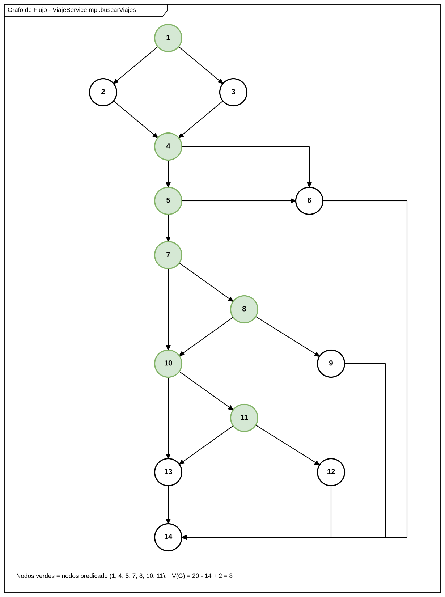

# Caja blanca: `ViajeServiceImpl.buscarViajes(origen, destino, fecha, pasajeros, franja)`

Autor: Alvaro Diego Mera Incio.

**Qué hace el método:** es la búsqueda de viajes de la HU 2.1. Si el pasajero no indica cuántos viajan,
asume 1. Luego valida tres reglas (de 1 a 6 pasajeros, origen distinto del destino y fecha que no sea pasada)
y, si todo está bien, pide al DAO los viajes que cumplen los cinco filtros y tienen asientos libres
suficientes.

## 1. Nodos del grafo de flujo

| Nodo | Instrucción |
|---|---|
| 1 | ¿`pasajeros == null`? (predicado) |
| 2 | `cantidad = 1` |
| 3 | `cantidad = pasajeros` |
| 4 | ¿`cantidad < 1`? (predicado) |
| 5 | ¿`cantidad > 6`? (predicado) |
| 6 | `throw ReglaNegocioException("La cantidad de pasajeros debe estar entre 1 y 6")` |
| 7 | ¿`origen != null`? (predicado) |
| 8 | ¿`origen.equals(destino)`? (predicado) |
| 9 | `throw ReglaNegocioException("El origen y el destino deben ser distintos")` |
| 10 | ¿`fecha != null`? (predicado) |
| 11 | ¿`fecha` es anterior a hoy? (predicado) |
| 12 | `throw ReglaNegocioException("La fecha de viaje no puede ser anterior a hoy")` |
| 13 | `return viajeDao.buscar(...)` convertido a DTO |
| 14 | Fin |

Las condiciones compuestas (`||` y `&&`) se separan en un nodo por condición.
Aristas: 1-2, 1-3, 2-4, 3-4, 4-5, 4-6, 5-6, 5-7, 6-14, 7-8, 7-10, 8-9, 8-10, 9-14, 10-11, 10-13, 11-12, 11-13,
12-14, 13-14 (20 aristas).

## 2. Complejidad ciclomática

V(G) = aristas − nodos + 2 = 20 − 14 + 2 = **8**. Comprobación: nodos predicado + 1 = 7 + 1 = 8
(nodos 1, 4, 5, 7, 8, 10 y 11). Como V(G) = 8 > 4, se necesitan 8 caminos independientes.

## 3. Caminos y casos de prueba

| Camino | Recorrido | Caso de prueba | Resultado esperado |
|---|---|---|---|
| C1 | 1-2-4-5-7-10-13-14 | Sin ningún filtro | Busca para 1 pasajero |
| C2 | 1-3-4-6-14 | pasajeros = 0 | `ReglaNegocioException` (1 a 6) |
| C3 | 1-3-4-5-6-14 | pasajeros = 7 | `ReglaNegocioException` (1 a 6) |
| C4 | 1-3-4-5-7-10-13-14 | pasajeros = 2, sin origen ni fecha | Busca para 2 pasajeros |
| C5 | 1-3-4-5-7-8-9-14 | origen = destino = Lima | `ReglaNegocioException` (distintos) |
| C6 | 1-3-4-5-7-8-10-13-14 | Lima → Ica, sin fecha | Busca Lima → Ica |
| C7 | 1-3-4-5-7-10-11-12-14 | fecha = ayer | `ReglaNegocioException` (fecha pasada) |
| C8 | 1-3-4-5-7-10-11-13-14 | fecha = mañana | Busca los viajes de mañana |

Los caminos C1, C2, C3, C5, C7 y C8 están automatizados en `BuscarViajesTest` (ver la prueba unitaria);
C4 y C6 se comprobaron en la caja negra (CP5 y CP1). El grafo editable está en `drawio/grafo_caja_blanca_buscar_viajes.drawio`.
