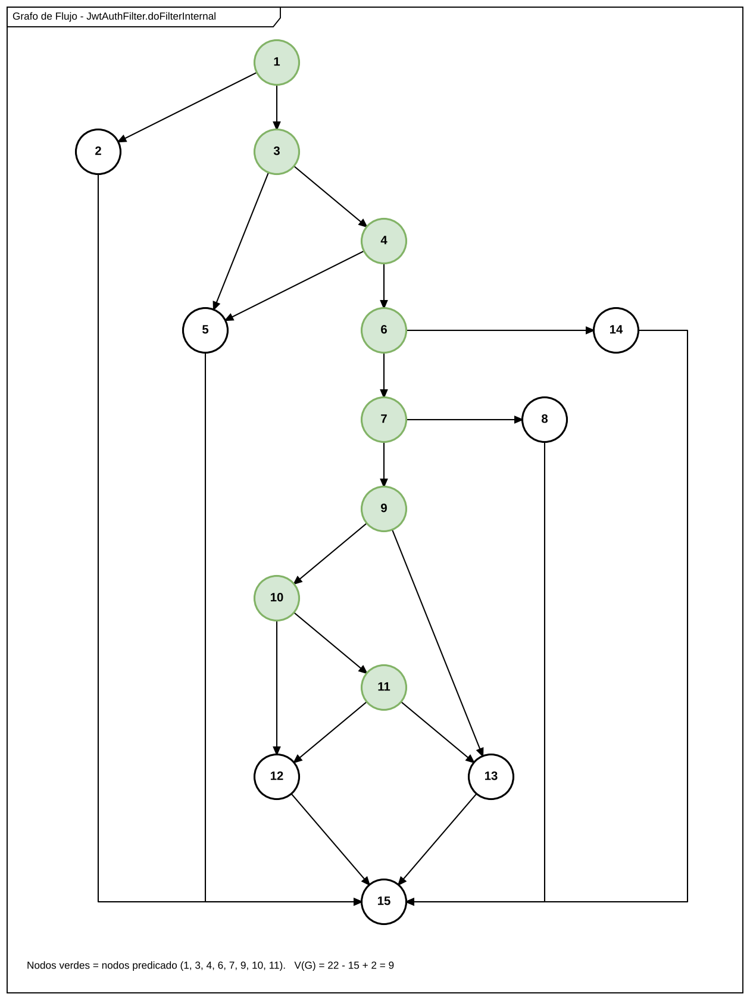

# Caja blanca: `JwtAuthFilter.doFilterInternal(request, response, chain)`

Autor: Reaid Yusef Barreto Ibrahim.

**Qué hace el método:** es la puerta de entrada de toda la API (HU 1.2). Deja pasar las rutas públicas
(login, registro, recuperación, enlace compartido y preflight OPTIONS). En las demás exige el header
`Authorization: Bearer <token>`, valida el JWT, rechaza la sesión si ya se cerró con logout y, en
`/api/admin/*`, exige el rol ADMINISTRADOR. Si todo está bien, deja el id y el email del usuario en la
solicitud para que los controladores los usen.

## 1. Nodos del grafo de flujo

| Nodo | Instrucción |
|---|---|
| 1 | ¿La ruta es pública (`esPublica`)? (predicado) |
| 2 | `chain.doFilter` sin pedir token y `return` |
| 3 | ¿`header == null`? (predicado) |
| 4 | ¿El header no empieza con `"Bearer "`? (predicado) |
| 5 | `sendError(401, "Falta el token de sesion")` |
| 6 | `jwtUtil.validarYObtenerClaims(token)`. ¿Lanza `TokenInvalidoException`? (predicado) |
| 7 | ¿La sesión fue cerrada (`sesionesCerradas.estaCerrada`)? (predicado) |
| 8 | `sendError(401, "La sesion fue cerrada")` |
| 9 | ¿La ruta empieza con `/api/admin/`? (predicado) |
| 10 | ¿`idRol == null`? (predicado) |
| 11 | ¿`idRol != 1` (no es administrador)? (predicado) |
| 12 | `sendError(403, "Solo un administrador puede hacer esta operacion")` |
| 13 | Guardar idUsuario, email, idToken y expiración en la solicitud; `chain.doFilter` |
| 14 | `catch (TokenInvalidoException)`: `sendError(401, mensaje)` |
| 15 | Fin |

Las condiciones compuestas (`||` y `&&`) se separan en un nodo por condición.
Aristas: 1-2, 1-3, 2-15, 3-4, 3-5, 4-5, 4-6, 5-15, 6-7, 6-14, 7-8, 7-9, 8-15, 9-10, 9-13, 10-11, 10-12, 11-12,
11-13, 12-15, 13-15, 14-15 (22 aristas).

## 2. Complejidad ciclomática

V(G) = aristas − nodos + 2 = 22 − 15 + 2 = **9**. Comprobación: nodos predicado + 1 = 8 + 1 = 9
(nodos 1, 3, 4, 6, 7, 9, 10 y 11). Como V(G) = 9 > 4, se necesitan 9 caminos independientes.

## 3. Caminos y casos de prueba

| Camino | Recorrido | Caso de prueba | Resultado esperado |
|---|---|---|---|
| C1 | 1-2-15 | `GET /api/publico/seguimiento/{token}` sin header | Pasa sin pedir sesión |
| C2 | 1-3-5-15 | `GET /api/viajes` sin header | 401 "Falta el token de sesion" |
| C3 | 1-3-4-5-15 | Header `Basic abc123` | 401 "Falta el token de sesion" |
| C4 | 1-3-4-6-14-15 | `Bearer` con un token alterado o vencido | 401 token inválido |
| C5 | 1-3-4-6-7-8-15 | Token válido después de hacer logout | 401 "La sesion fue cerrada" |
| C6 | 1-3-4-6-7-9-13-15 | Pasajero consulta `GET /api/viajes` | Pasa; idUsuario guardado en la solicitud |
| C7 | 1-3-4-6-7-9-10-12-15 | Token sin el dato `rol` en `/api/admin/viajes` | 403 |
| C8 | 1-3-4-6-7-9-10-11-12-15 | Pasajero (rol 2) en `/api/admin/viajes` | 403 |
| C9 | 1-3-4-6-7-9-10-11-13-15 | Administrador (rol 1) en `/api/admin/viajes` | Pasa |

C1, C2, C5 y C8 ya están automatizados en `JwtAuthFilterTest`; C2, C4, C6, C8 y C9 también se ven en las
cajas negras del equipo (por ejemplo CP18 de la búsqueda y CP19 del retraso). El grafo editable está en
`drawio/grafo_caja_blanca_jwt_filter.drawio`.
