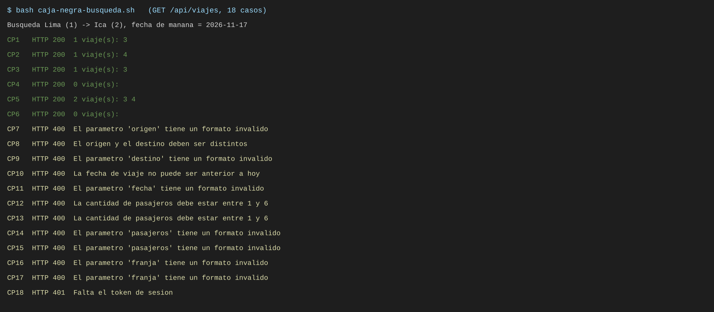

# Prueba de caja negra: búsqueda de viajes

**Responsable:** Alvaro Diego Mera Incio
**Historia de usuario:** HU 2.1, buscar viajes y horarios
**Funcionalidad probada:** `GET /api/viajes` (pantalla Buscar viajes)
**Técnicas:** partición equivalente y análisis de valores límite
**Fecha de ejecución:** 16/11/2026, con `scripts/caja-negra-busqueda.sh`
**Resultado:** 18 de 18 casos con el resultado esperado

## 1. Datos de entrada (5)

| # | Dato | Condición |
|---|---|---|
| 1 | `origen` | Opcional: id numérico de un terminal |
| 2 | `destino` | Opcional: id numérico de un terminal, distinto del origen |
| 3 | `fecha` | Opcional: fecha válida (aaaa-mm-dd) desde hoy en adelante |
| 4 | `pasajeros` | Opcional (por defecto 1): entero de 1 a 6; solo salen viajes con esa cantidad de asientos libres |
| 5 | `franja` | Opcional: `MANANA` (antes de 12:00), `TARDE` (12:00 a 17:59) o `NOCHE` (desde 18:00) |

Precondición: sesión de pasajero (`cliente@bustracka.pe`).

## 2. Clases de equivalencia

| Dato | Clases válidas | Clases no válidas |
|---|---|---|
| `origen` | (1) terminal existente; (2) terminal que no existe (lista vacía) | (3) no numérico |
| `destino` | (4) terminal distinto del origen | (5) igual al origen; (6) no numérico |
| `fecha` | (7) hoy o después | (8) fecha pasada; (9) fecha inexistente |
| `pasajeros` | (10) de 1 a 6 | (11) 0; (12) más de 6; (13) texto; (14) decimal |
| `franja` | (15) uno de los 3 valores; (16) sin franja | (17) valor fuera de la lista; (18) en minúsculas |

## 3. Casos de prueba y resultados

Datos de `seed.sql`: Lima (1) → Ica (2) mañana tiene el viaje 3 a las 08:00 y el viaje 4 a las 20:00.
Cada caso cambia un solo dato respecto al CP1.

| CP | Datos (lo que cambia respecto al CP1) | Clases | Esperado | Obtenido |
|---|---|---|---|---|
| 1 | origen 1, destino 2, mañana, 2 pasajeros, `MANANA` | (1)(4)(7)(10)(15) | 200, viaje 3 | 200, viaje 3 (pasa) |
| 2 | 1 pasajero, `NOCHE` | límite inferior | 200, viaje 4 | 200, viaje 4 (pasa) |
| 3 | 6 pasajeros | límite superior | 200, viaje 3 | 200, viaje 3 (pasa) |
| 4 | `TARDE` | (15) | 200, ningún viaje | 200, 0 viajes (pasa) |
| 5 | sin franja | (16) | 200, viajes 3 y 4 | 200, viajes 3 y 4 (pasa) |
| 6 | origen 999 | (2) | 200, ningún viaje | 200, 0 viajes (pasa) |
| 7 | origen "abc" | (3) | 400 | 400 (pasa) |
| 8 | destino 1 (igual al origen) | (5) | 400 | 400 (pasa) |
| 9 | destino "abc" | (6) | 400 | 400 (pasa) |
| 10 | fecha de ayer | (8) | 400 | 400 (pasa) |
| 11 | fecha 2026-13-45 | (9) | 400 | 400 (pasa) |
| 12 | 0 pasajeros | (11) | 400 | 400 (pasa) |
| 13 | 7 pasajeros | (12) | 400 | 400 (pasa) |
| 14 | pasajeros "abc" | (13) | 400 | 400 (pasa) |
| 15 | 2.5 pasajeros | (14) | 400 | 400 (pasa) |
| 16 | franja `MADRUGADA` | (17) | 400 | 400 (pasa) |
| 17 | franja `manana` | (18) | 400 | 400 (pasa) |
| 18 | CP1 sin token de sesión | precondición | 401 | 401 (pasa) |

Valores límite: 1 y 6 pasajeros (CP2, CP3) y sus vecinos 0 y 7 (CP12, CP13); fecha de ayer como vecina de hoy (CP10).

