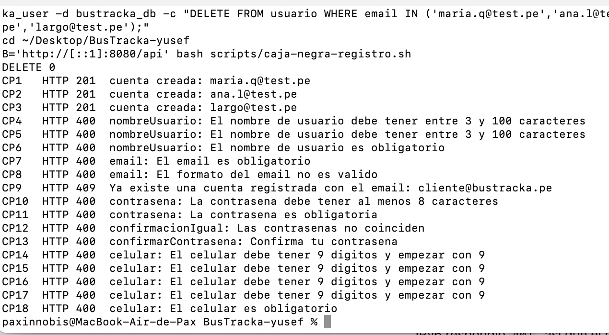

# Prueba de caja negra: registro de usuario

**Responsable:** Reaid Yusef Barreto Ibrahim
**Historia de usuario:** HU 1.1, registrarse en la aplicación
**Funcionalidad probada:** `POST /api/auth/register` (pantalla Crear cuenta)
**Técnicas:** partición equivalente y análisis de valores límite
**Fecha de ejecución:** 16/11/2026, con `scripts/caja-negra-registro.sh`
**Resultado:** 18 de 18 casos con el resultado esperado

## 1. Datos de entrada (5)

| # | Dato | Condición |
|---|---|---|
| 1 | `nombreUsuario` | Texto obligatorio de 3 a 100 caracteres |
| 2 | `email` | Obligatorio, con formato de correo y que no esté registrado |
| 3 | `contrasena` | Obligatoria, mínimo 8 caracteres (se guarda como hash BCrypt) |
| 4 | `confirmarContrasena` | Obligatoria e igual a la contraseña |
| 5 | `celular` | Obligatorio: 9 dígitos y empieza con 9 (celular peruano) |

Precondición: ninguna, el registro es una ruta pública (no pide sesión).

## 2. Clases de equivalencia

| Dato | Clases válidas | Clases no válidas |
|---|---|---|
| `nombreUsuario` | (1) de 3 a 100 caracteres | (2) menos de 3; (3) más de 100; (4) vacío o solo espacios |
| `email` | (5) formato válido y nuevo | (6) nulo; (7) sin formato de correo; (8) ya registrado |
| `contrasena` | (9) 8 o más caracteres | (10) menos de 8; (11) nula |
| `confirmarContrasena` | (12) igual a la contraseña | (13) distinta; (14) nula |
| `celular` | (15) 9 dígitos que empiezan con 9 | (16) 8 dígitos; (17) 10 dígitos; (18) no empieza con 9; (19) con letras; (20) nulo |

## 3. Casos de prueba y resultados

Cada caso no válido cambia un solo dato respecto al CP1. La contraseña de los casos es `Secreta123`.

| CP | Datos (lo que cambia respecto al CP1) | Clases | Esperado | Obtenido |
|---|---|---|---|---|
| 1 | mariaq, maria.q@test.pe, Secreta123, Secreta123, 987654321 | (1)(5)(9)(12)(15) | 201, cuenta creada | 201 (pasa) |
| 2 | nombre de 3 letras, contraseña de 8, celular 900000000 | límites inferiores | 201 | 201 (pasa) |
| 3 | nombre de 100 letras, celular 999999999 | límites superiores | 201 | 201 (pasa) |
| 4 | nombre "an" (2 letras) | (2) | 400 | 400 (pasa) |
| 5 | nombre de 101 letras | (3) | 400 | 400 (pasa) |
| 6 | nombre "   " | (4) | 400 | 400 (pasa) |
| 7 | email nulo | (6) | 400 | 400 (pasa) |
| 8 | email "maria.test.pe" | (7) | 400 | 400 (pasa) |
| 9 | email "cliente@bustracka.pe" (ya existe) | (8) | 409 | 409 (pasa) |
| 10 | contraseña "Abc1234" (7) | (10) | 400 | 400 (pasa) |
| 11 | contraseña nula | (11) | 400 | 400 (pasa) |
| 12 | confirmación "Secreta124" | (13) | 400 "Las contrasenas no coinciden" | 400 (pasa) |
| 13 | confirmación nula | (14) | 400 | 400 (pasa) |
| 14 | celular "98765432" | (16) | 400 | 400 (pasa) |
| 15 | celular "9876543210" | (17) | 400 | 400 (pasa) |
| 16 | celular "887654321" | (18) | 400 | 400 (pasa) |
| 17 | celular "98765432a" | (19) | 400 | 400 (pasa) |
| 18 | celular nulo | (20) | 400 | 400 (pasa) |

Valores límite: 3 y 100 caracteres en el nombre (CP2, CP3) y sus vecinos 2 y 101 (CP4, CP5); 8 caracteres en
la contraseña (CP2) y 7 (CP10); 9 dígitos en el celular (CP1) y sus vecinos 8 y 10 (CP14, CP15).

