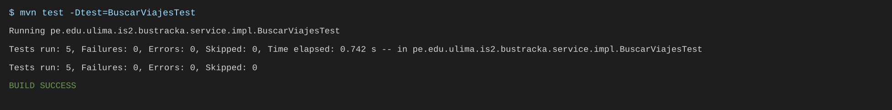

# Prueba unitaria: `ViajeServiceImpl.buscarViajes`

Autor: Alvaro Diego Mera Incio. Clase: `backend/src/test/java/.../service/impl/BuscarViajesTest.java` (JUnit 5 y Mockito).

El DAO se reemplaza por un doble de Mockito, así la prueba no necesita la base de datos y solo revisa las
reglas del servicio.

| # | Prueba | Entrada | Resultado esperado |
|---|---|---|---|
| 1 | `buscaConLosCincoFiltrosValidos` | Lima → Ica, mañana, 2 pasajeros, `MANANA` | Devuelve el viaje 3 |
| 2 | `sinCantidadDePasajerosBuscaParaUnPasajero` | Sin filtros | El DAO se llama con 1 pasajero |
| 3 | `rechazaCeroOMasDeSeisPasajeros` | 0 y 7 pasajeros | `ReglaNegocioException`, el DAO no se llama |
| 4 | `rechazaOrigenIgualAlDestino` | origen = destino = 1 | `ReglaNegocioException` "El origen y el destino deben ser distintos" |
| 5 | `rechazaUnaFechaPasada` | fecha de ayer | `ReglaNegocioException`, el DAO no se llama |

Ejecución: `mvn test -Dtest=BuscarViajesTest`, 5 de 5 en verde.

