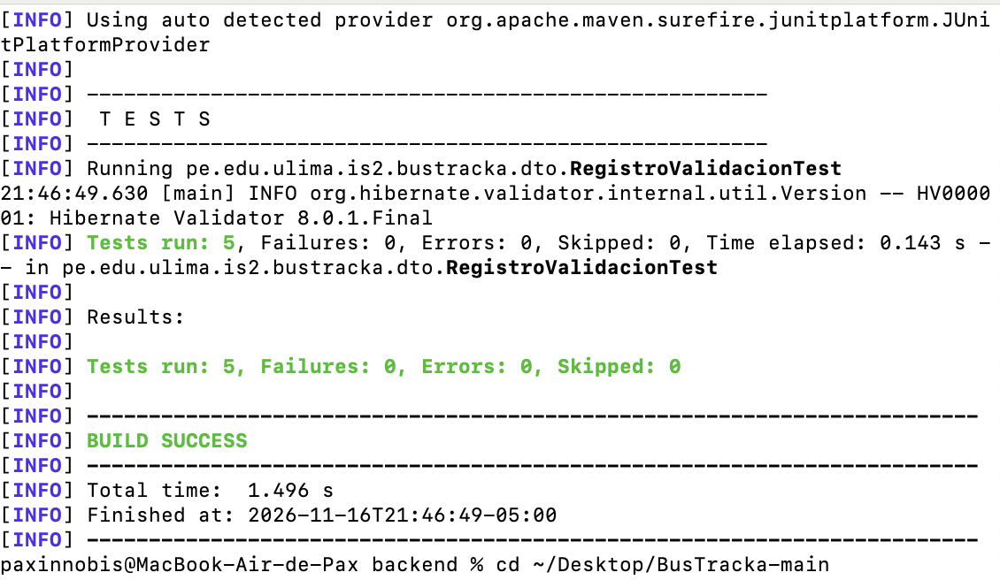

# Prueba unitaria: reglas de `RegisterRequestDTO`

Autor: Reaid Yusef Barreto Ibrahim. Clase: `backend/src/test/java/.../dto/RegistroValidacionTest.java` (JUnit 5).

Usa el mismo validador que aplica `@Valid` en `AuthController`, sin levantar Spring ni la base de datos.
Cada caso inválido debe producir exactamente un error, en el campo indicado.

| # | Prueba | Entrada | Resultado esperado |
|---|---|---|---|
| 1 | `aceptaUnRegistroValido` | mariaq, maria.q@test.pe, Secreta123 ×2, 987654321 | Sin errores |
| 2 | `rechazaContrasenasQueNoCoinciden` | confirmación Secreta124 | Error en `confirmacionIgual` |
| 3 | `rechazaCelularDeOchoDigitos` | celular 98765432 | Error en `celular` |
| 4 | `rechazaCelularQueNoEmpiezaCon9` | celular 887654321 | Error en `celular` |
| 5 | `rechazaEmailSinArroba` | email maria.test.pe | Error en `email` |

Ejecución: `mvn test -Dtest=RegistroValidacionTest`, 5 de 5 en verde.

